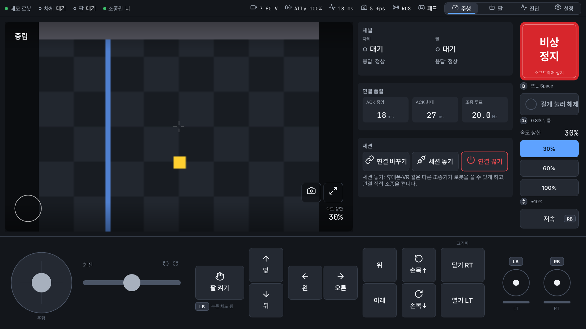
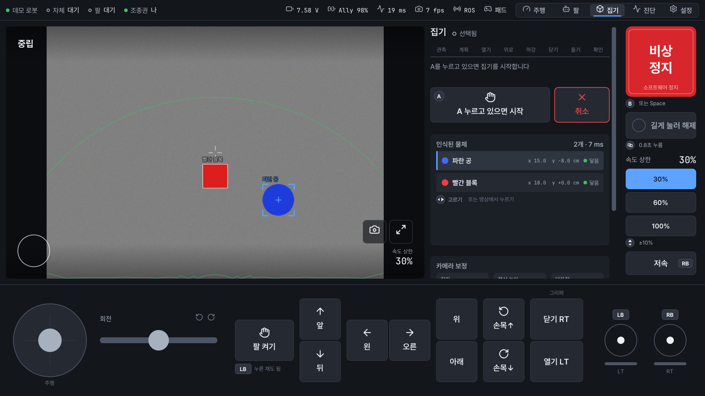

# ArmPi Ally Controller

**A C++17 Windows app that turns an ASUS ROG Ally X handheld into a full controller for the Hiwonder ArmPi Pro robot (mecanum base + 5-axis arm + gripper), including camera-based object picking.**

[한국어 README](README.md) · MIT licence · Win32 + Direct3D 11 + Dear ImGui · one static exe, no runtime DLLs




## What it does

| Robot feature | In the app |
|---|---|
| Mecanum base (forward, strafe, turn) | Proportional analog sticks with a response curve, speed limit 10–100 %, slow mode, virtual touch stick, optional **tilt driving** (hold RT and tilt the handheld) |
| Arm tip target (x, y, z, pitch) + gripper | LB dead-man + sticks, touch buttons, tap/drag on top and side views, numeric goals. Every goal is rate-limited (0.15 m/s) |
| **Object picking** | Grasp tab: colour/shape detection of blocks and balls, pick one on the screen or with the D-pad, then **hold A**: observe → plan → confirm → open → hover → descend → close → lift → verify. Release A and the arm stops where it is |
| E-stop / clear | B, Space or the on-screen button fire on touch-down (any finger); clearing needs a 0.8 s hold |
| Robot status and services | Battery, faults, control owner, joint states, home pose, robot-wide stop (rosbridge) |
| Camera | MJPEG stream with a HUD |

## Engineering highlights

- **Safety first.** Robot rules (Protocol v3 per-channel neutral confirmation, 0.4 s watchdog, latched e-stop) plus app rules: dead-man for the arm and for every automatic motion, neutral on focus loss / input loss / pad unplug, rate-limited goals, reach filtering, table floor for grasping, experimental features off by default. See `docs/SAFETY_KO.md` (rules 1–24).
- **Own vision stack, no OpenCV.** HSV thresholding, 8-connected components with moments (circularity and oriented fill tell blocks from balls), frame-to-frame tracking, a normalised-DLT table homography, and an object-height (parallax) correction. About 6 ms per 640×480 frame on its own thread.
- **Closed-loop simulation.** A synthetic table camera (`tools/fake_cam_server.py`) follows the mock robot's odometry over rosbridge, so the whole pick — including driving the base towards an out-of-reach object — runs end to end in CI without hardware.
- **Handheld features.** XInput rumble patterns per event, multi-touch through Windows pointer messages (a second finger can hit the e-stop while the first holds the stick — verified on the device with injected touches), accelerometer tilt driving via the Windows Sensor API on a separate thread, 120 Hz flip-model swap chain, sleep prevention, Ally battery display.
- **Security.** The robot protocol has no authentication, so inputs from the network are size- and range-limited (camera frames, MJPEG parts, WebSocket/JSON, forged robot poses), DLLs load from System32 only, ASLR/DEP/stack protection are checked in CI. See `docs/SECURITY_KO.md`.

## Tests

| What | Result |
|---|---|
| Unit tests (protocol helpers, mapper, haptics, security limits, tilt maths) | 77/77 |
| Vision + autograsp unit tests (detection, homography, calibration files, planner, the whole state machine incl. dead-man, e-stop, interventions, base approach, intrusion check) | 180/180 |
| Mock robot end-to-end (discovery, drive, arm ramps, reach limit, e-stop, rosbridge, camera, joint debug) | 21/21 |
| Autograsp end-to-end (mock robot + synthetic camera: pick, pause/resume, e-stop abort, base approach then pick) | 22/22 |
| On the Ally X | GUI rendering, network self-test, injected two-finger touch → e-stop, accelerometer readout |
| Real robot | **not yet** — hardware tests and a demo video come next |

```bash
scripts/build_win.sh                       # cross-compile the Windows exes (mingw-w64)
scripts/build_mac.sh                       # portable core + unit tests (macOS/Linux)
test/e2e_mock.sh /path/to/ArmPro_Cpp_ROS2
test/e2e_grasp_mock.sh /path/to/ArmPro_Cpp_ROS2
```

## Layout

```
src/net     sockets (Winsock/POSIX), UDP link, discovery, HTTP/MJPEG, WebSocket
src/robot   RobotCore (20 Hz control loop), rosbridge, camera, autograsp planner + sequencer
src/vision  detector, homography, calibration, detection thread
src/input   XInput pad + haptics, input mapper, tilt sensor
src/app     GUI (Win32/D3D11/ImGui) and console tool
```

## Limitations

Not yet tested on the real robot. Object picking assumes single-colour blocks and balls on a flat table and uses commanded (not measured) arm positions. Base approach and the intrusion check are experimental and off by default. Code is not signed (Windows Smart App Control blocks unsigned exes).

Documentation is mostly in Korean; this page is the English summary.
