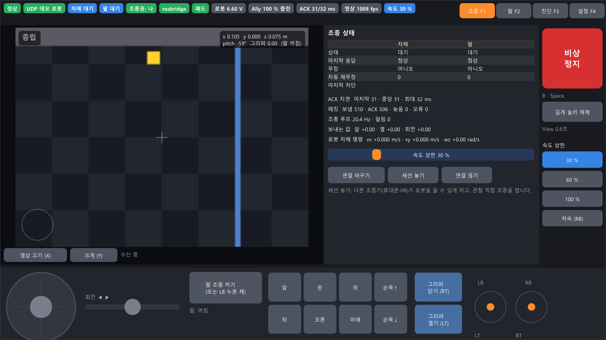
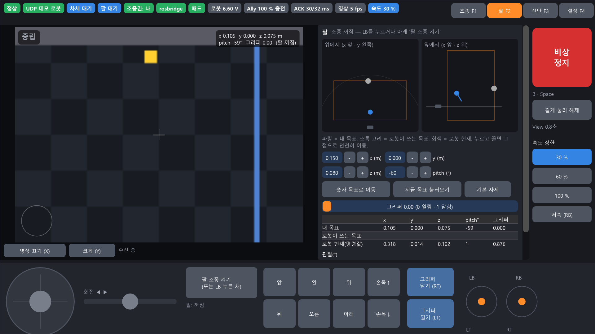

# ArmPi Ally Controller

**휴대용 게임 PC(ASUS ROG Ally X) 하나로 Hiwonder ArmPi Pro 로봇(메카넘 차체 + 5축 팔 + 그리퍼)의 모든 기능을 조종하는 C++ Windows 앱.**

   



| 팔 탭: 위·옆 그림을 눌러 목표 지정 |
|---|
|  |

> 위 화면은 Ally X에서 앱이 직접 저장한 것이다(`--screenshot`). 로봇 대신 가짜 로봇에 연결된 상태다. 실제 로봇 시연 GIF는 실기 시험 뒤 추가한다.

## 왜 만들었나

이 로봇은 휴대폰 앱·웹·VR로 조종할 수 있었지만, 화면 버튼은 "누르면 일정 속도"뿐이라 미세한 조작이 어렵다. 휴대용 게임 PC에는 아날로그 스틱·트리거·진동·터치 화면이 한 손 안에 다 있다. 이것을 로봇의 조종 규칙(채널별 중립 확인, watchdog, 비상정지)에 맞춰 안전하게 묶는 것이 목표였다.

## 주요 기능

| 로봇 기능 | 앱에서 |
|---|---|
| 메카넘 차체 앞뒤·평행이동·회전 | 왼스틱·오른스틱 비례 조종, 응답 곡선, 속도 상한 10–100 %, 저속 버튼 |
| 팔 손끝 절대 목표(x, y, z, pitch) | LB 데드맨 + 스틱, 터치 버튼, **팔 위·옆 그림을 눌러 목표 지정**, 숫자 입력. 모든 목표는 속도 제한 램프로 이동 |
| 그리퍼 0(열림)–1(닫힘) | RT/LT 누른 깊이에 비례, 터치 버튼, 슬라이더 |
| 비상정지·해제 | B / Space / 화면 버튼(한 번), View·화면 버튼 0.8초(해제) |
| 로봇 검색(UDP 5002) | 연결 화면의 "로봇 찾기" |
| 로봇 상태(rosbridge) | 배터리, 비상정지 출처, 고장, 조종권, 팔 현재·적용 목표, 관절 값, 차체 명령 |
| 로봇 서비스 | 기본 자세, 로봇 전체 정지·해제(길게 + 확인) |
| 관절 직접 조종 | 진단 탭 슬라이더 6개(세션을 놓았을 때만) |
| 카메라(MJPEG) | 영상 + HUD(상태, 팔 목표, 주행 벡터, 알림) |
| 세션 관리 | 연결·끊기·세션 놓기(다른 조종기에 양보)·새 세션 |

## Ally 특성 활용

- **아날로그 비례 조종**: 스틱 원형 데드존 + `|v|^1.6` 곡선으로 저속 미세 조작.
- **진동 피드백**: 비상정지(강하게), 통신 끊김(두 번), 팔이 닿는 범위의 끝(짧게), 로봇 거부, 서비스 성공·실패를 패턴으로 구분.
- **터치**: 큰 버튼, 가상 스틱, 팔 그림에 직접 목표 찍기, IP 입력용 숫자판.
- **화면 꺼짐 방지**: 연결된 동안 잠자기를 막는다(꺼지면 포커스를 잃고 로봇이 멈춘다).
- **배터리**: 로봇 배터리와 Ally 배터리를 함께 표시.
- **120 Hz 화면**: 플립 모델 스왑체인 + vsync. 배터리를 아끼려면 60·30 fps로 제한.

## 구조

조종(20 Hz)·화면·rosbridge·카메라가 각각 다른 스레드에서 돈다. 화면이 멈춰도 비상정지 재전송과 중립 전환은 계속된다. 자세한 그림은 [`docs/ARCHITECTURE.md`](docs/ARCHITECTURE.md).

```
src/net     Winsock/POSIX 소켓 계층, UDP 링크, 검색, HTTP·MJPEG, WebSocket
src/robot   RobotCore(20 Hz 조종 루프·팔 램프·보정), RosBridge, CameraFeed
src/input   XInput 게임패드·진동 패턴, Mapper(패드+키+터치 → 조종 입력, 순수 로직)
src/app     armpi-ally.exe(Win32 + D3D11 + Dear ImGui), armpi-ally-cli(검색·자체 시험·패드 확인)
third_party Protocol v3 클라이언트·JSON·기구학(로봇 저장소 발췌), Dear ImGui, stb_image
```

공용 코드는 맥·리눅스에서도 빌드되어, 실제 로봇 없이 **가짜 로봇 종단 시험**을 돌린다.

## 빌드

```bash
# Windows exe (맥: brew install mingw-w64 / 우분투: apt install mingw-w64)
scripts/build_win.sh          # build-win/armpi-ally.exe, build-win/armpi-ally-cli.exe (외부 DLL 없음)

# 공용 코드 + 단위 시험 (맥/리눅스)
scripts/build_mac.sh
```

## 실행

1. Ally와 로봇을 같은 와이파이에 둔다. Armoury Crate는 **게임패드 모드**여야 내장 패드가 잡힌다.
2. `armpi-ally.exe` 실행 → "로봇 찾기" 또는 IP 입력 → 연결.
3. 처음에는 **바퀴를 띄우고** 속도 10–30 %로 시작한다. [`docs/SAFETY_KO.md`](docs/SAFETY_KO.md)

조작 전체는 [`docs/CONTROLS_KO.md`](docs/CONTROLS_KO.md).

## 시험

```bash
build-mac/ally_unit_tests                         # 단위 시험 65개 항목(보안 한계 포함)
test/e2e_mock.sh /path/to/ArmPro_Cpp_ROS2         # 가짜 로봇 종단 시험 21개 항목
armpi-ally-cli.exe selftest --robot <로봇 IP>     # Windows에서 같은 종단 시험
armpi-ally-cli.exe pads --rumble 300              # 내장 게임패드·진동 확인
armpi-ally.exe --smoke-test --screenshot shot.bmp # 화면 앱 시작·렌더링 점검(시작 기록: %LOCALAPPDATA%\ArmPi_Ally_Controller\boot.log)
```

| 확인한 것 | 결과 |
|---|---|
| 단위 시험(맥, Windows 빌드) | 65/65 통과 |
| 가짜 로봇 종단 시험(맥) | 21/21 통과: 검색, 차체, 팔 램프(한 틱 최대 7.5 mm), 범위 밖 목표 정지, 비상정지·해제, 상태·서비스, 카메라, 관절 직접 조종, 새 세션 |
| Windows 콘솔 exe를 Ally에서 실행, 망 너머 가짜 로봇 | 자체 시험 통과(ACK 중앙값 약 31 ms, 조종 루프 20.1 Hz), 내장 패드 XInput 슬롯 0 인식 |
| 화면 exe(armpi-ally.exe)를 Ally 데스크톱에서 실행 | D3D11 하드웨어(플립 모델), 맑은 고딕, 1080p 렌더링, 가짜 로봇 자동 연결·영상, 화면 저장, 정상 종료 확인(`--smoke-test`) |
| 손으로 하는 조작(패드·터치·진동) | 사용자 확인 필요 |
| 실제 로봇 | 아직 |

## 보안

앱과 로봇 사이 통신에는 **인증·암호화가 없다**(로봇 규격). 같은 와이파이에 있는 누구나 로봇에 명령을 보내거나 상태·영상을 위조할 수 있다. **신뢰할 수 있는 사설 망에서만** 쓴다. 앱은 위조·거대 입력에도 죽거나 팔을 엉뚱한 곳으로 보내지 않도록 입력 크기·범위를 제한한다. 점검 내용과 남은 위험은 [`docs/SECURITY_KO.md`](docs/SECURITY_KO.md)에 있다.

## 한계·미확인

- 코드 서명이 없다. Windows 11 **스마트 앱 컨트롤**이 켜진 PC에서는 서명 없는 exe가 막힌다(끄거나, 신뢰할 수 있는 인증서로 서명해야 실행됨).
- 패드·터치·진동을 손으로 조작해 본 확인은 아직이다(자동 점검은 화면 렌더링과 연결까지).
- 실제 로봇에서 시험하지 않았다(가짜 로봇과 망 너머 시험만).
- 터치는 한 점만 처리한다(두 손가락 동시 조작은 다음 단계).
- 기울기(자이로) 조종은 넣지 않았다. Ally 센서가 Windows 센서 API로 보이는지 확인한 뒤 결정한다.
- 앱 쪽 팔 보정은 링크 길이만 쓴다(관절 범위는 로봇마다 달라 로봇의 보정을 최종으로 따른다).

## 라이선스

[MIT](LICENSE). 함께 넣은 외부 코드의 라이선스는 [`THIRD_PARTY_NOTICES.md`](THIRD_PARTY_NOTICES.md).
