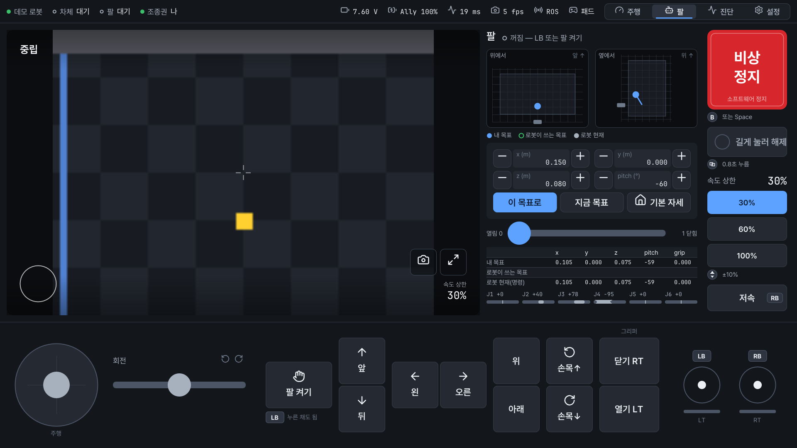
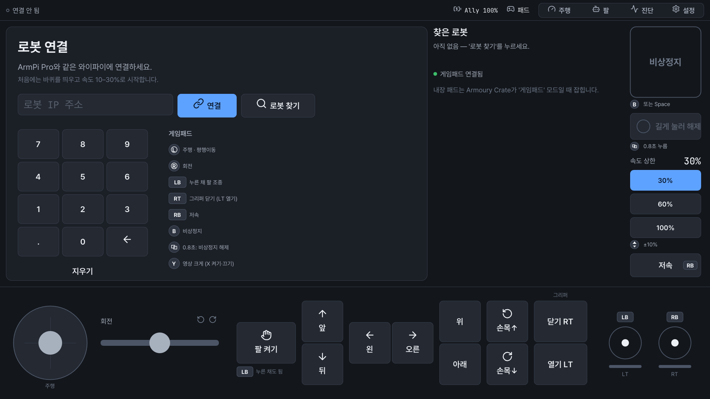
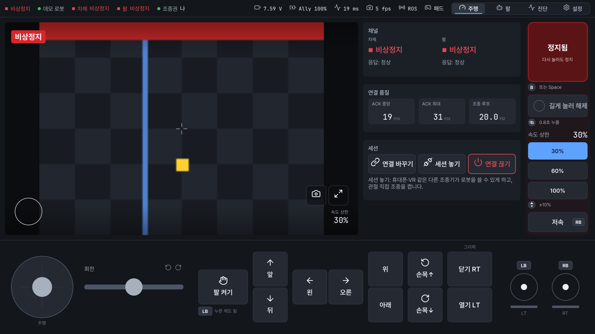
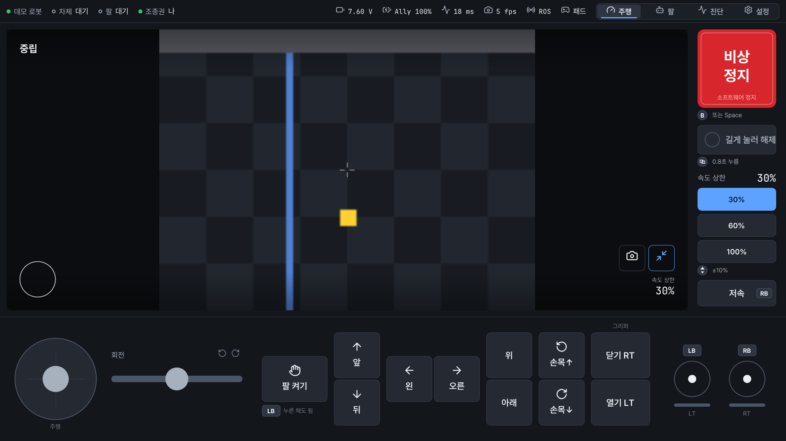

# ArmPi Ally Controller

**휴대용 게임 PC(ASUS ROG Ally X) 하나로 Hiwonder ArmPi Pro 로봇(메카넘 차체 + 5축 팔 + 그리퍼)의 모든 기능을 조종하는 C++ Windows 앱.**

[English summary](README.en.md)

   


| 팔: 위·옆 그림을 눌러 목표 지정 | 연결: 숫자판·로봇 찾기·패드 안내 |
|---|---|
|  |  |
| **비상정지 상태**: 버튼·상단·HUD만 빨강 | **영상 크게(Y)**: 안전 열은 그대로 |
|  |  |

**집기 탭**: 카메라가 색 블록·공을 찾고, 고른 물체(파란 테두리)를 A를 누르고 있는 동안 팔이 스스로 집어 든다. 초록 선은 팔이 닿는 책상 범위다(가짜 카메라 영상). 물체가 범위 밖이면 차체가 천천히 다가가게 할 수도 있다(시험 기능).


> 위 화면은 Ally X에서 앱이 직접 저장한 것이다(`--screenshot`). 로봇 대신 가짜 로봇에 연결된 상태다(주소는 '데모 로봇'으로 가림). 집기 탭 영상은 시험용 합성 카메라(`tools/fake_cam_server.py`)다. 실제 로봇 시연 GIF는 실기 시험 뒤 추가한다.

### 디자인

"어두운 계기판 위에 영상 하나, 빨간 버튼 하나." 로봇 원격 조종 UI(Foxglove, QGroundControl), 휴대용 게임기 UI, FPV OSD, 산업용 HMI(ISA-101) 사례를 조사해 다시 그렸다([`docs/DESIGN_PLAN_v001.md`](docs/DESIGN_PLAN_v001.md)).
- 색은 상태와 선택에만 쓴다. 표면은 무채색 5단계이고, 상태는 색과 모양과 글자로 함께 보인다(● 정상, ○ 대기, ▲ 주의, ■ 위험). 색약이어도 구분된다.
- 비상정지는 항상 같은 자리에 있다. 상태는 준비·정지됨·비활성 세 가지이고, **누르는 순간** 발동한다. 해제는 진행 링이 차도록 0.8초 길게 누른다.
- 게임패드 배지(B, LB, View…)는 직접 그린다. 숫자는 고정폭(JetBrains Mono)이라 값이 바뀌어도 화면이 흔들리지 않는다. 터치 목표는 64–112 px다.

## 왜 만들었나

이 로봇은 휴대폰 앱·웹·VR로 조종할 수 있었지만, 화면 버튼은 "누르면 일정 속도"뿐이라 미세한 조작이 어렵다. 휴대용 게임 PC에는 아날로그 스틱·트리거·진동·터치 화면이 한 손 안에 다 있다. 이것을 로봇의 조종 규칙(채널별 중립 확인, watchdog, 비상정지)에 맞춰 안전하게 묶는 것이 목표였다.

## 주요 기능

| 로봇 기능 | 앱에서 |
|---|---|
| 메카넘 차체 앞뒤·평행이동·회전 | 왼스틱·오른스틱 비례 조종, 응답 곡선, 속도 상한 10–100 %, 저속 버튼 |
| 팔 손끝 절대 목표(x, y, z, pitch) | LB 데드맨 + 스틱, 터치 버튼, **팔 위·옆 그림을 눌러 목표 지정**, 숫자 입력. 모든 목표는 속도 제한 램프로 이동 |
| 그리퍼 0(열림)–1(닫힘) | RT/LT 누른 깊이에 비례, 터치 버튼, 슬라이더 |
| 비상정지·해제 | B / Space / 화면 버튼(한 번), View·화면 버튼 0.8초(해제) |
| 로봇 검색(UDP 5002) | 연결 화면의 "로봇 찾기" |
| 로봇 상태(rosbridge) | 배터리, 비상정지 출처, 고장, 조종권, 팔 현재·적용 목표, 관절 값, 차체 명령 |
| 로봇 서비스 | 기본 자세, 로봇 전체 정지·해제(길게 + 확인) |
| 관절 직접 조종 | 진단 탭 슬라이더 6개(세션을 놓았을 때만) |
| 카메라(MJPEG) | 영상 + HUD(상태, 팔 목표, 주행 벡터, 알림) |
| **물체 인식·자동 집기** | 집기 탭: 영상에서 색 블록·공을 찾아 목록과 영상에 표시 → 영상을 누르거나 D-pad로 고름 → **A를 누르고 있는 동안** 팔이 관측·계획·열기·위로·하강·닫기·들기·확인을 스스로 한다. 놓으면 그 자리에 선다. 카메라 보정 마법사(물체 높이 보정 포함), 색 다시 찍기. 시험 기능: 범위 밖 물체로 차체 자동 접근, 작업 영역 침입 감지 |
| 세션 관리 | 연결·끊기·세션 놓기(다른 조종기에 양보)·새 세션 |

## Ally 특성 활용

- **아날로그 비례 조종**: 스틱 원형 데드존 + `|v|^1.6` 곡선으로 저속 미세 조작.
- **진동 피드백**: 비상정지(강하게), 통신 끊김(두 번), 팔이 닿는 범위의 끝(짧게), 로봇 거부, 서비스 성공·실패를 패턴으로 구분.
- **터치(멀티터치)**: 큰 버튼, 가상 스틱, 팔 그림에 직접 목표 찍기, 영상에서 집을 물체 누르기, IP 입력용 숫자판. 한 손가락으로 스틱을 잡은 채 다른 손가락으로 버튼·비상정지를 누를 수 있다.
- **기울기 주행(설정)**: RT를 누른 동안 Ally를 앞뒤로 기울이면 전진·후진, 좌우로 기울이면 회전. 누른 순간의 자세가 기준이다(내장 가속도계, Windows 센서 API).
- **A 버튼 = 자동 동작 데드맨**: 자동 집기는 A를 누르고 있는 동안만 움직인다. 손을 떼면 바로 선다.
- **화면 꺼짐 방지**: 연결된 동안 잠자기를 막는다(꺼지면 포커스를 잃고 로봇이 멈춘다).
- **배터리**: 로봇 배터리와 Ally 배터리를 함께 표시.
- **120 Hz 화면**: 플립 모델 스왑체인 + vsync. 배터리를 아끼려면 60·30 fps로 제한.

## 구조

조종(20 Hz)·화면·rosbridge·카메라가 각각 다른 스레드에서 돈다. 화면이 멈춰도 비상정지 재전송과 중립 전환은 계속된다. 자세한 그림은 [`docs/ARCHITECTURE.md`](docs/ARCHITECTURE.md).

```
src/net     Winsock/POSIX 소켓 계층, UDP 링크, 검색, HTTP·MJPEG, WebSocket
src/robot   RobotCore(20 Hz 조종 루프·팔 램프·보정), RosBridge, CameraFeed, 자동 집기(계획·순서)
src/vision  색·모양 물체 검출, 책상 평면 호모그래피, 카메라 보정 파일, 검출 스레드(외부 라이브러리 없음)
src/input   XInput 게임패드·진동 패턴, Mapper(패드+키+터치 → 조종 입력, 순수 로직), 기울기 센서(Windows 센서 API)
src/app     armpi-ally.exe(Win32 + D3D11 + Dear ImGui), armpi-ally-cli(검색·자체 시험·패드 확인)
third_party Protocol v3 클라이언트·JSON·기구학(로봇 저장소 발췌), Dear ImGui, stb_image
```

공용 코드는 맥·리눅스에서도 빌드되어, 실제 로봇 없이 **가짜 로봇 종단 시험**을 돌린다.

## 빌드

```bash
# Windows exe (맥: brew install mingw-w64 / 우분투: apt install mingw-w64)
scripts/build_win.sh          # build-win/armpi-ally.exe, build-win/armpi-ally-cli.exe (외부 DLL 없음)

# 공용 코드 + 단위 시험 (맥/리눅스)
scripts/build_mac.sh
```

## 실행

1. Ally와 로봇을 같은 와이파이에 둔다. Armoury Crate는 **게임패드 모드**여야 내장 패드가 잡힌다. 평소 버튼·스틱을 바꿔 쓴다면 이 앱을 Armoury Crate SE 게임 라이브러리에 추가해 **앱 전용 프로필을 기본 배치로** 두는 것을 권한다(아래 조작표의 'Armoury Crate SE' 절).
2. `armpi-ally.exe` 실행 → "로봇 찾기" 또는 IP 입력 → 연결.
3. 처음에는 **바퀴를 띄우고** 속도 10–30 %로 시작한다. [`docs/SAFETY_KO.md`](docs/SAFETY_KO.md)

조작 전체는 [`docs/CONTROLS_KO.md`](docs/CONTROLS_KO.md).

## 시험

```bash
build-mac/ally_unit_tests                         # 단위 시험 77개 항목(보안 한계·기울기 계산 포함)
build-mac/ally_vision_tests                       # 인식·보정·집기 순서·차체 접근·침입 감지 단위 시험 180개 항목(가짜 로봇)
test/e2e_mock.sh /path/to/ArmPro_Cpp_ROS2         # 가짜 로봇 종단 시험 21개 항목
test/e2e_grasp_mock.sh /path/to/ArmPro_Cpp_ROS2   # 가짜 로봇 + 합성 카메라로 자동 집기·차체 접근 종단 시험 22개 항목
armpi-ally-cli.exe tilt --seconds 10              # 기울기 센서 값과 기울기 주행 값 보기(로봇에는 아무것도 보내지 않음)
armpi-ally-cli.exe selftest --robot <로봇 IP>     # Windows에서 같은 종단 시험
armpi-ally-cli.exe pads --rumble 300              # 내장 게임패드·진동 확인
armpi-ally.exe --smoke-test --screenshot shot.bmp # 화면 앱 시작·렌더링 점검(시작 기록: %LOCALAPPDATA%\ArmPi_Ally_Controller\boot.log)
#   --demo-connect HOST --demo-ports BASE --tab drive|arm|grasp|diag|settings --demo-state estop|cambig|grasp
#   --demo-calib vision_calib.json  (문서용 화면. 데모 실행은 설정·보정 파일을 저장하지 않는다)
#   --demo-touch  (가짜 로봇 연결 + 자동 점검일 때만: 두 손가락 터치를 주입해 스틱을 잡은 채 비상정지가 되는지 확인)
```

| 확인한 것 | 결과 |
|---|---|
| 단위 시험(맥, Windows 빌드) | 77/77 통과 |
| 인식·보정·집기 순서 단위 시험(맥) | 180/180 통과: HSV·블롭·모양 구분, 추적 ID, 호모그래피 복원·잡음·퇴화, 보정 파일 범위 검사, 물체 높이(시차) 보정, 색 찍기, 계획(바닥 금지선·도달 불가), 전체 순서, A 놓음·비상정지·연결 끊김·사용자 개입·확인 시간 초과·하강 정지 재시도·확인 실패, 차체 접근(회전·전진·멈춤, A 놓으면 차체 정지, 속도 상한 30 % 초과 거부, 물체 놓침, 영상이 멈추면 진척 없음으로 중단, 도중에 옵션을 끄면 정지), 침입 감지(작업 영역 밖 큰 변화만 정지, 팔이 움직이기 전 화면 전체 변화는 정지, 팔이 움직이는 동안 계속되면 카메라가 팔에 달린 것으로 보고 꺼짐) |
| 자동 집기 종단 시험(맥, 가짜 로봇 + 합성 카메라) | 22/22 통과: 인식(처리 약 6 ms) → 계획 오차 0 mm → 집어 들기 → 영상 확인, A를 놓으면 일시정지·팔 목표 고정, 다시 누르면 같은 단계, 비상정지면 중단, 팔 범위 밖 물체에 차체가 약 7초 다가간 뒤 집기 완료(합성 카메라가 가짜 로봇의 주행 기록을 따라 물체를 움직임) |
| 가짜 로봇 종단 시험(맥) | 21/21 통과: 검색, 차체, 팔 램프(한 틱 최대 7.5 mm), 범위 밖 목표 정지, 비상정지·해제, 상태·서비스, 카메라, 관절 직접 조종, 새 세션 |
| Windows 콘솔 exe를 Ally에서 실행, 망 너머 가짜 로봇 | 자체 시험 통과(ACK 중앙값 약 31 ms, 조종 루프 20.1 Hz), 내장 패드 XInput 슬롯 0 인식 |
| 화면 exe(armpi-ally.exe)를 Ally 데스크톱에서 실행 | D3D11 하드웨어(플립 모델), 맑은 고딕, 1080p 렌더링, 가짜 로봇 자동 연결·영상, 화면 저장, 정상 종료 확인(`--smoke-test`). 집기 탭: 합성 카메라 영상에서 후보 2개 인식·도달 범위·선택 표시 확인 |
| 멀티터치(Ally, 터치 주입) | 첫 손가락이 주행 스틱을 누른 채 두 번째 손가락이 비상정지를 누르면 8 ms 뒤 비상정지 송신·ACK |
| 기울기 센서(Ally) | Windows 센서 API로 가속도계 읽기 확인(책상 위: 약 −1 g, pitch 90.7°). 센서는 별도 스레드에서 읽고(한 번 약 25 ms), 1초 넘게 갱신이 없으면 기울기 입력을 0으로 |
| 손으로 하는 조작(패드·터치·진동·기울기 방향) | 사용자 확인 필요 |
| 실제 로봇 | 아직 |

## 보안

앱과 로봇 사이 통신에는 **인증·암호화가 없다**(로봇 규격). 같은 와이파이에 있는 누구나 로봇에 명령을 보내거나 상태·영상을 위조할 수 있다. **신뢰할 수 있는 사설 망에서만** 쓴다. 앱은 위조·거대 입력에도 죽거나 팔을 엉뚱한 곳으로 보내지 않도록 입력 크기·범위를 제한한다. 점검 내용과 남은 위험은 [`docs/SECURITY_KO.md`](docs/SECURITY_KO.md)에 있다.

## 한계·미확인

- 코드 서명이 없다. Windows 11 **스마트 앱 컨트롤**이 켜진 PC에서는 서명 없는 exe가 막힌다(끄거나, 신뢰할 수 있는 인증서로 서명해야 실행됨).
- 패드·터치·진동을 손으로 조작해 본 확인은 아직이다(자동 점검은 화면 렌더링과 연결까지).
- 실제 로봇에서 시험하지 않았다(가짜 로봇과 망 너머 시험만).
- 기울기 주행의 방향(앞으로 기울이면 전진, 오른쪽을 내리면 우회전)은 축 정의로 계산했고, 손에 들고 확인하지는 않았다.
- 앱 쪽 팔 보정은 링크 길이만 쓴다(관절 범위는 로봇마다 달라 로봇의 보정을 최종으로 따른다).
- 자동 집기는 **실제 로봇·카메라에서 아직 시험하지 않았다.** 위치는 명령값 기준이라 실제 손끝 오차(링크 길이·서보)를 모른다. 첫 실기 절차는 [`docs/SAFETY_KO.md`](docs/SAFETY_KO.md)에 있다.
- 인식은 단색 블록·공(색 + 모양)만 한다. 무늬가 있거나 색이 비슷한 물체, 강한 그림자에는 약하다.
- 차체 자동 접근과 작업 영역 침입 감지는 **시험 기능**이다(기본 꺼짐). 주행 기록(odometry)이 없어 영상만 보고 움직이며, 실제 로봇·카메라로는 아직 확인하지 않았다. 침입 감지는 차체에 고정된 카메라에서만 의미가 있고 보조 수단이다(믿고 손을 넣으면 안 된다).

## 라이선스

[MIT](LICENSE). 함께 넣은 외부 코드의 라이선스는 [`THIRD_PARTY_NOTICES.md`](THIRD_PARTY_NOTICES.md).
