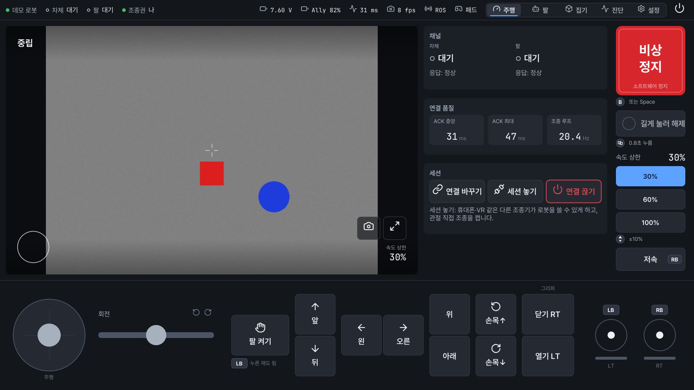
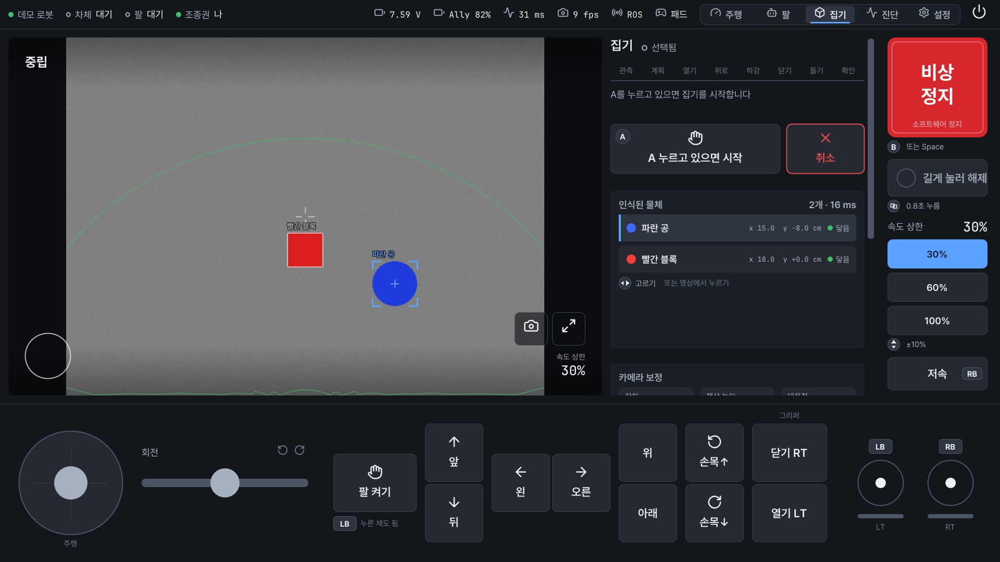
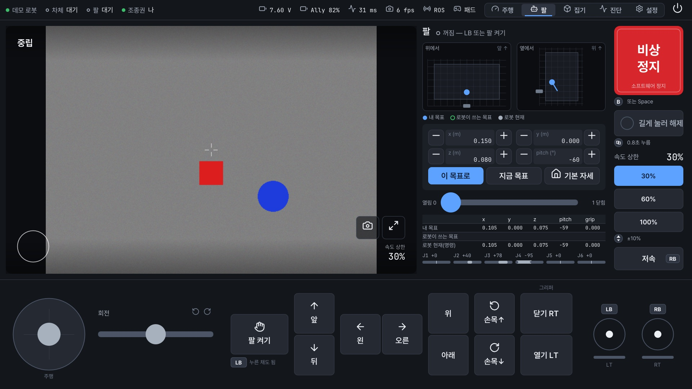
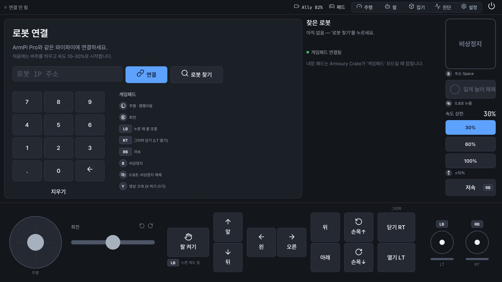
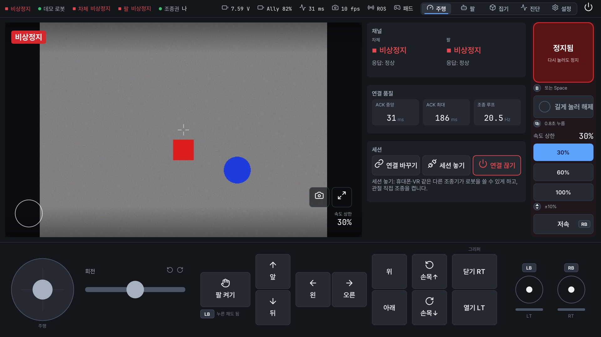
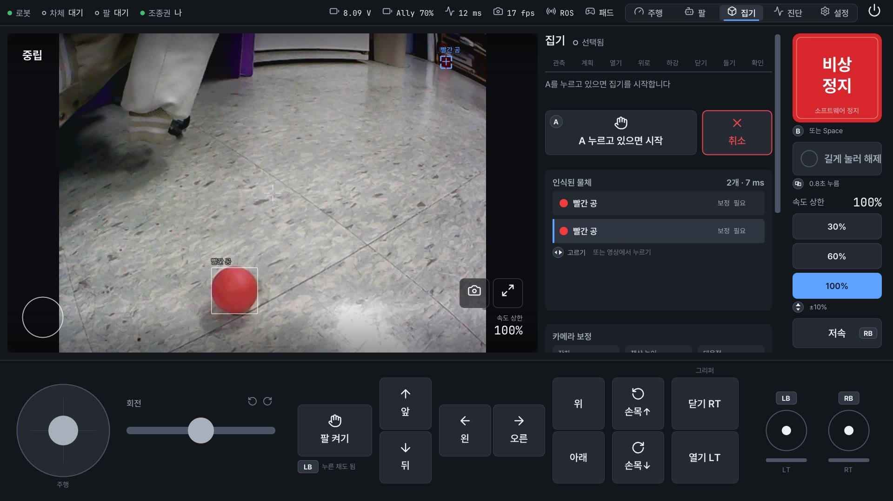

# ArmPi Ally Controller

**휴대용 게임 PC(ASUS ROG Ally X) 하나로 Hiwonder ArmPi Pro 로봇(메카넘 차체 + 5축 팔 + 그리퍼)을 조종하고, 카메라로 찾은 물체를 팔이 스스로 집어 들게 하는 C++ Windows 앱.**

현재 버전 **0.4.3** · [English summary](README.en.md) · [조작](docs/CONTROLS_KO.md) · [안전](docs/SAFETY_KO.md) · [구조](docs/ARCHITECTURE.md) · [보안](docs/SECURITY_KO.md) · [변경 기록](CHANGELOG.md)

   



| 집기: 인식한 물체를 골라 A를 누르고 있으면 팔이 집어 든다 | 팔: 위·옆 그림을 눌러 목표 지정 |
|---|---|
|  |  |
| **연결**: 숫자판·로봇 찾기·패드 안내 | **비상정지**: 버튼·상단·영상 표시만 빨강 |
|  |  |

> 위 다섯 장은 Ally X에서 앱이 직접 저장한 것이다(`--screenshot`). 로봇 대신 가짜 로봇에 연결했고(주소는 '데모 로봇'으로 가림), 영상은 시험용 합성 카메라(`tools/fake_cam_server.py`)다.



> 이 한 장은 **실제 ArmPi Pro**에 연결해 저장한 화면이다(2026-11-16, 앱 0.4.2, 원격 화면 저장). 실제 카메라 영상에서 빨간 공을 인식했고(뒤쪽 붉은 물건 하나도 공으로 잘못 잡혔다), 카메라 보정 전이라 '보정 필요'로 표시된다. 상단은 로봇 배터리 8.09 V, ACK 중앙값 12 ms, 영상 17 fps. 결과는 [실제 로봇 첫 시험](#실제-로봇-첫-시험2026-11-16).

## 무엇을 하나

| 로봇 기능 | 앱에서 |
|---|---|
| 메카넘 차체(앞뒤·평행이동·회전) | 스틱 비례 조종(응답 곡선), 속도 상한 10–100 %, 저속, 화면 가상 스틱, **기울기 주행**(RT를 누른 채 Ally를 기울임) |
| 팔 손끝 목표(x, y, z, pitch)·그리퍼 | LB 데드맨 + 스틱, 화면 버튼, 팔 위·옆 그림 누르기, 숫자 입력. 모든 목표는 속도 제한(0.15 m/s)으로 천천히 이동 |
| **물체 인식·자동 집기** | 카메라에서 색 블록·공을 찾고, 고른 물체를 **A를 누르고 있는 동안** 관측 → 계획 → 열기 → 위로 → 하강 → 닫기 → 들기 → 확인. 놓으면 그 자리에 선다. 카메라 보정 마법사, 색 다시 찍기. [시험 기능] 범위 밖 물체로 차체 접근, 작업 영역 침입 감지 |
| 비상정지·해제 | B / Space / 화면 버튼(닿는 순간, 어느 손가락이든), 해제는 0.8초 길게 |
| 로봇 상태·서비스(rosbridge) | 배터리, 고장, 조종권, 팔 현재·적용 목표, 관절 값, 기본 자세, 로봇 전체 정지·해제 |
| 관절 직접 조종 | 진단 탭 슬라이더 6개(조종 세션을 놓았을 때만) |
| 카메라(MJPEG) | 영상 + 표시(상태, 팔 목표, 주행 벡터, 알림), 크게 보기 |
| 검색·세션 | 로봇 찾기(UDP 5002), 연결·끊기·세션 놓기(다른 조종기에 양보)·새 세션 |

### Ally를 쓰는 방식

- **아날로그 조종**: 원형 데드존 + `|v|^1.6` 곡선으로 저속 미세 조작.
- **진동**: 비상정지(강하게), 통신 끊김(두 번), 팔이 닿는 범위의 끝(짧게), 로봇 거부, 서비스·집기 성공·실패를 패턴으로 구분.
- **멀티터치**: 한 손가락으로 가상 스틱을 잡은 채 다른 손가락으로 버튼·비상정지를 누를 수 있다.
- **기울기 주행**(설정): 내장 가속도계(Windows 센서 API). 누른 순간의 자세가 기준.
- **A = 자동 동작 데드맨**, **화면 꺼짐 방지**(연결된 동안), **로봇·Ally 배터리 함께 표시**, **120 Hz 화면**(60·30 fps 제한 가능).

## 빠른 시작

1. **설치**: `armpi-ally.exe`(화면 앱)와 `armpi-ally-cli.exe`(콘솔 도구)를 한 폴더에 둔다. 외부 DLL은 필요 없다. 직접 빌드하거나([빌드와 시험](#빌드와-시험)), GitHub Actions의 `armpi-ally-win64` 결과물을 받는다.
2. **Armoury Crate SE**: 제어 모드를 **게임패드**로 둔다. 평소 버튼·스틱을 바꿔 쓴다면 이 앱을 게임 라이브러리에 추가해 **앱 전용 프로필을 기본 배치로** 둔다([방법](docs/CONTROLS_KO.md#armoury-crate-se에-이-앱-등록하기권장)).
3. **연결**: Ally와 로봇을 같은 와이파이에 두고 앱을 실행 → '로봇 찾기' 또는 IP 입력 → 연결. 처음에는 **바퀴를 띄우고 속도 10–30 %**로 시작한다([안전](docs/SAFETY_KO.md)).
4. **끄기**: 화면 맨 위 오른쪽 끝 전원 아이콘을 **두 번**(3초 안) 누른다. 로봇은 중립, 연결을 끊고 설정을 저장한 뒤 꺼진다.

- 로봇 없이도 **설정 탭**은 열린다(포트·스틱·기울기 주행 등). 다른 탭은 연결 뒤에 쓴다.
- 설정·보정·기록 파일은 `%LOCALAPPDATA%\ArmPi_Ally_Controller\`에 있다: `settings.json`, `vision_calib.json`(카메라 보정), `vision_colors.json`(색 다시 찍기), `ally_*.log`(최근 20개), `boot.log`(시작 기록).

## 자동 집기

```
[보정 한 번] 관측 자세 → 책상 높이 → 대응점 4–6개 → (물체 높이 보정) → 저장
[집기]       영상에서 물체 고르기 → A 누르고 있기 → 관측 → 계획 → 하강 전 확인(A 다시) → 열기 → 위로 → 하강 → 닫기 → 들기 → 확인
```

- 인식은 OpenCV 없이 직접 구현했다: HSV 색 마스크, 8연결 덩어리와 모멘트(테두리가 중심에서 고르게 떨어져 있으면 공, 같은 모멘트의 직사각형을 채우면 블록. 비스듬히 놓인 블록도 블록으로 본다), 프레임 사이 추적. 640×480 한 장에 약 6 ms, 별도 스레드.
- 영상 좌표는 책상 평면 호모그래피(정규화 DLT)로 로봇 좌표가 된다. 카메라가 비스듬해 생기는 물체 높이 밀림도 보정한다.
- 계획은 pitch −90°/−75°/−60°/−50° 중 위로·잡기·들기가 모두 닿는 첫 값을 고른다. 하강은 책상 + 5 mm 아래로 내려가지 않고, 하강·들기는 0.06 m/s로 느리다.
- **시험 기능(기본 꺼짐)**: 물체가 팔 범위 밖이면 차체가 아주 천천히 다가간다(속도 상한 30 % 이하, 2초마다 멈춰 보기, 모두 20초). 작업 영역에 큰 물체가 들어오면 일시정지한다(차체 고정 카메라용).

## 안전 요약

전체 규칙 24개는 [`docs/SAFETY_KO.md`](docs/SAFETY_KO.md)에 있다.

- **놓으면 멈춘다.** 팔은 LB, 자동 집기는 A, 기울기 주행은 RT를 누르고 있는 동안만 움직인다.
- **저절로 다시 움직이지 않는다.** 포커스 복귀·탭 전환·패드 재연결 뒤에는 버튼을 한 번 놓았다가 다시 눌러야 하고, 스틱은 한 번 가운데로 돌아와야 한다.
- **입력이 끊기면 중립.** 포커스 상실, 0.3초 입력 없음, 패드 분리, 앱 종료 때 중립을 보낸다. 앱이 죽으면 로봇 watchdog(0.4초)이 세운다.
- **비상정지는 닿는 순간.** 어느 손가락·버튼으로든, 창 포커스가 없어도(B) 걸린다. ACK가 올 때까지 다시 보낸다.
- **팔 목표는 점프하지 않는다.** 속도 제한 램프, 앱 쪽 도달 범위 보정, 로봇 보정 따라가기(5 cm 안만).

## 구조

조종(20 Hz)·화면·rosbridge·카메라·검출·기울기 센서가 각각 다른 스레드에서 돈다. 화면이 멈춰도 비상정지 재전송과 중립 전환은 계속되고, 자동 집기는 화면이 멈추면 함께 선다. 자세한 그림은 [`docs/ARCHITECTURE.md`](docs/ARCHITECTURE.md).

```
src/net     Winsock/POSIX 소켓 계층, UDP 링크, 검색, HTTP·MJPEG, WebSocket
src/robot   RobotCore(20 Hz 조종 루프·팔 램프·보정), RosBridge, CameraFeed, 자동 집기(계획·순서)
src/vision  색·모양 물체 검출, 책상 평면 호모그래피, 카메라 보정 파일, 검출 스레드
src/input   XInput 게임패드·진동, Mapper(패드+키+터치 → 조종 입력, 순수 로직), 기울기 센서
src/app     armpi-ally.exe(Win32 + D3D11 + Dear ImGui), armpi-ally-cli
tools       fake_cam_server.py(시험용 합성 카메라)
third_party Protocol v3 클라이언트·JSON·기구학(로봇 저장소 발췌), Dear ImGui, stb_image, 글꼴
```

**디자인**: "어두운 계기판 위에 영상 하나, 빨간 버튼 하나." 색은 상태와 선택에만 쓰고, 상태는 색·모양·글자로 함께 보인다(● 정상, ○ 대기, ▲ 주의, ■ 위험). 숫자는 고정폭, 터치 목표는 64–112 px. 글꼴(Pretendard, JetBrains Mono)과 아이콘(Lucide 부분 집합)은 exe에 내장했다. 계획: [`docs/DESIGN_PLAN_v001.md`](docs/DESIGN_PLAN_v001.md).

## 빌드와 시험

```bash
scripts/build_win.sh    # Windows exe 크로스 빌드(맥: brew install mingw-w64 / 우분투: apt install mingw-w64)
scripts/build_mac.sh    # 공용 코드 + 단위 시험(맥/리눅스)

test/e2e_mock.sh /path/to/ArmPro_Cpp_ROS2         # 가짜 로봇 종단 시험
test/e2e_grasp_mock.sh /path/to/ArmPro_Cpp_ROS2   # 가짜 로봇 + 합성 카메라로 자동 집기·차체 접근
```

콘솔 도구 `armpi-ally-cli`:

| 명령 | 하는 일 |
|---|---|
| `discover [--target IP]` | 로봇 찾기 |
| `selftest --robot IP` | 조종·상태·영상·관절 직접 조종 종단 시험 |
| `grasp-selftest --robot IP --camera-url URL --calib FILE` | 자동 집기 종단 시험(127.0.0.1이 아니면 `--yes-arm-moves` 필요) |
| `pads [--rumble ms]` | 내장 게임패드 값·진동 확인 |
| `tilt [--seconds N]` | 기울기 센서 값과 기울기 주행 값(로봇에는 아무것도 보내지 않음) |

**실행 중인 앱 화면 저장**: Ally에서 F12나 진단 탭의 '화면 저장', 또는 맥에서 `scripts/ally_capture.sh user@host [키] [폴더] [shot | burst N 초]`(원격 요청 → JPEG 한 장 또는 GIF). 저장하는 동안 로봇 주소·이름은 가린다. 시험 기록과 README 사진은 이것으로 남긴다.

화면 앱 점검: `armpi-ally.exe --smoke-test --screenshot shot.bmp`, 문서용 옵션 `--demo-connect HOST --demo-ports BASE --tab drive|arm|grasp|diag|settings --demo-state estop|cambig|grasp --demo-calib FILE --demo-touch`(데모 실행은 설정·보정 파일을 저장하지 않는다).

| 확인한 것 | 결과 |
|---|---|
| 단위 시험 | 86/86: 프로토콜 도우미, 입력 변환, 진동, 보안 한계, 기울기 계산, 화면 저장 주소 가리기, 글자 경계 자르기 |
| 인식·집기 단위 시험 | 203/203: 검출(0–60° 회전 블록·여러 크기 공)·호모그래피·보정 파일·계획·도달 범위·순서 전체(데드맨, 비상정지, 개입, 재시도), 차체 접근, 침입 감지 |
| 가짜 로봇 종단 시험 | 21/21: 검색, 차체, 팔 램프, 범위 밖 목표, 비상정지·해제, 상태·서비스, 카메라, 관절 직접 조종, 새 세션 |
| 자동 집기 종단 시험 | 22/22: 인식 → 집어 들기 → 영상 확인, A 놓으면 일시정지, 비상정지면 중단, 범위 밖 물체에 차체가 다가간 뒤 집기(합성 카메라가 가짜 로봇의 주행 기록을 따라감) |
| Ally X에서 | 화면 렌더링(D3D11 플립 모델, 1080p), 망 너머 자체 시험(ACK 중앙값 약 31 ms, 조종 루프 20 Hz), 두 손가락 터치 주입 → 비상정지 8 ms, 가속도계 읽기, 스틱·버튼·진동(사용자 확인) |
| 실제 로봇 | **2026-11-16 첫 실기(앱 0.4.2)**: 연결·rosbridge·영상 수신, 팔 조종, 비상정지 6회 모두 ACK(5–16 ms)·해제 2회(15–16 ms), 실제 카메라에서 공 인식 — 앱 기록·저장 화면 기준. 주행·그리퍼는 기록에 남지 않는 항목이라 사용자 보고("잘됨")만 있다. **자동 집기는 실기에서 아직 동작하지 않는다**(원인 조사 중). 아래 표 |

CI(GitHub Actions)는 우분투에서 Windows exe를 크로스 빌드해 PE 보안 플래그(ASLR·DEP)를 검사하고, 단위 시험과 두 종단 시험을 돌린다.

### 실제 로봇 첫 시험(2026-11-16)

Ally X와 ArmPi Pro를 같은 와이파이에 두고 앱 0.4.2로 세 번 연결했다(약 2분, 30초, 3분 이상). 출처를 나눠 적는다: **앱 기록**은 `ally_*.log`의 사건과 시각(앱 쪽 시계), **저장 화면**은 위 사진, **사용자 보고**는 조종한 사람의 말이다.

| 항목 | 앱 기록·저장 화면 | 사용자 보고 |
|---|---|---|
| 연결 | 세 번 모두 조종 세션 → rosbridge → 영상 수신이 1초 안에 시작. 영상 스트림이 한 번 다시 시작됨. rosbridge 실패·예기치 않은 끊김 없음 | 잘됨 |
| 비상정지 | 6회 송신, 6회 모두 ACK. 송신→ACK 5–16 ms. 해제 2회, 요청→확인 15–16 ms. 비상정지 중 LB는 "팔 조종 꺼짐(비상정지)"로 4회 거부(설계대로) | 잘됨 |
| 팔 | LB로 켤 때마다 로봇이 보고한 현재 자세로 목표를 맞춤(기본 자세 x 0.105, y 0.000, z 0.075 m에서 시작). 세션 중 보고 자세가 바뀜(예: x 0.179, y −0.070, z 0.179) = 팔이 움직임. "로봇이 알린 보정 목표가 내 목표와 너무 멀어 무시함" 경고 2회(5 cm 따라가기 한계) | 잘됨 |
| 주행·그리퍼 | 기록하지 않는 항목 → 확인 안 됨 | 잘됨 |
| 카메라·인식 | 17 fps. 실제 바닥의 빨간 공 인식(2개 · 7 ms, 그중 하나는 뒤쪽 붉은 물건 오검출) | — |
| ACK 중앙값·로봇 배터리 | 12 ms, 8.09 V(저장 시점) | — |
| **자동 집기** | 집기 시작·실패 기록 없음. 기기에 카메라 보정 파일(`vision_calib.json`)이 없고 화면은 '보정 필요' 표시 | **아직 안 됨**(원인 조사 중) |
| 카메라 보정·차체 접근·침입 감지·기울기 주행 | 기록 없음 → 안 함 | — |

조종 루프 Hz와 ACK 분포는 기록 파일에 남지 않아 저장 화면의 중앙값 한 개만 적었다. 안전 문서의 [첫 시험 절차](docs/SAFETY_KO.md#실제-로봇-첫-시험)에 단계별 결과를 적어 두었다.

## 보안

앱과 로봇 사이 통신에는 **인증·암호화가 없다**(로봇 규격). 같은 와이파이에 있는 누구나 로봇에 명령을 보내거나 상태·영상을 위조할 수 있으므로 **신뢰할 수 있는 사설 망에서만** 쓴다. 앱은 위조·거대 입력에도 죽거나 팔을 엉뚱한 곳으로 보내지 않도록 입력 크기·범위를 제한한다. 자세한 점검과 남은 위험은 [`docs/SECURITY_KO.md`](docs/SECURITY_KO.md).

## 한계와 다음 단계

- **실제 로봇에서는 수동 조종까지 확인했다**(2026-11-16). **자동 집기는 실기에서 아직 동작하지 않는다**(원인 조사 중). 자동 집기의 위치는 명령값 기준이라 실제 손끝 오차도 아직 모른다.
- 인식은 단색 블록·공만 한다. 무늬·비슷한 색·강한 그림자에는 약하다. 영상에서 한 변·지름이 20 px 안팎인 작은 물체는 블록과 공을 헷갈릴 수 있다(45° 돌아간 20 px 블록은 공으로, 반지름 8 px 공은 블록으로 나온다).
- 차체 자동 접근과 침입 감지는 시험 기능이다. 주행 기록(odometry) 없이 영상만 보고, 침입 감지는 보조 수단이다.
- 기울기 주행 방향은 축 정의로 계산했다. 손으로 들고 방향을 확인해야 한다(`armpi-ally-cli tilt`).
- 앱 쪽 팔 보정은 링크 길이만 쓰고, 관절 범위는 로봇의 보정을 따른다.
- 코드 서명이 없다. Windows **스마트 앱 컨트롤**이 켜져 있으면 실행이 막힌다.
- 다음: 자동 집기가 실기에서 안 되는 원인 찾기 → 실기 측정(집게 폭·닫힘 값·카메라 위치·해상도) → 카메라 보정 → 집기 성공률 기록 → 시연 영상.

## 문서

| 문서 | 내용 |
|---|---|
| [`docs/CONTROLS_KO.md`](docs/CONTROLS_KO.md) | 화면 구성, 게임패드·키보드·터치 조작, 탭별 기능, Armoury Crate SE 설정 |
| [`docs/SAFETY_KO.md`](docs/SAFETY_KO.md) | 안전 규칙 24개, 실패 처리, 실제 로봇 첫 시험 절차와 2026-11-16 첫 실기 기록 |
| [`docs/ARCHITECTURE.md`](docs/ARCHITECTURE.md) | 구성 요소·스레드, 팔 목표 흐름, 자동 집기·멀티터치·기울기 구조, 파일 |
| [`docs/SECURITY_KO.md`](docs/SECURITY_KO.md) | 위협 모델, 점검·수정 내역, 남은 위험 |
| [`docs/DESIGN_PLAN_v001.md`](docs/DESIGN_PLAN_v001.md) | 화면 디자인 계획(0.2.0) |
| [`CHANGELOG.md`](CHANGELOG.md) | 버전별 변경 |
| [`THIRD_PARTY_NOTICES.md`](THIRD_PARTY_NOTICES.md) | 함께 넣은 외부 코드·글꼴 라이선스 |

## 라이선스

[MIT](LICENSE). 함께 넣은 외부 코드(`third_party/`)는 각자의 라이선스를 따른다: [`THIRD_PARTY_NOTICES.md`](THIRD_PARTY_NOTICES.md).

개인 프로젝트이며 Hiwonder, ASUS와 관계없다. "Hiwonder", "ArmPi", "ASUS", "ROG Ally" 등 제품 이름은 각 소유자의 상표이고, 대상 하드웨어를 가리키는 데만 쓴다.
