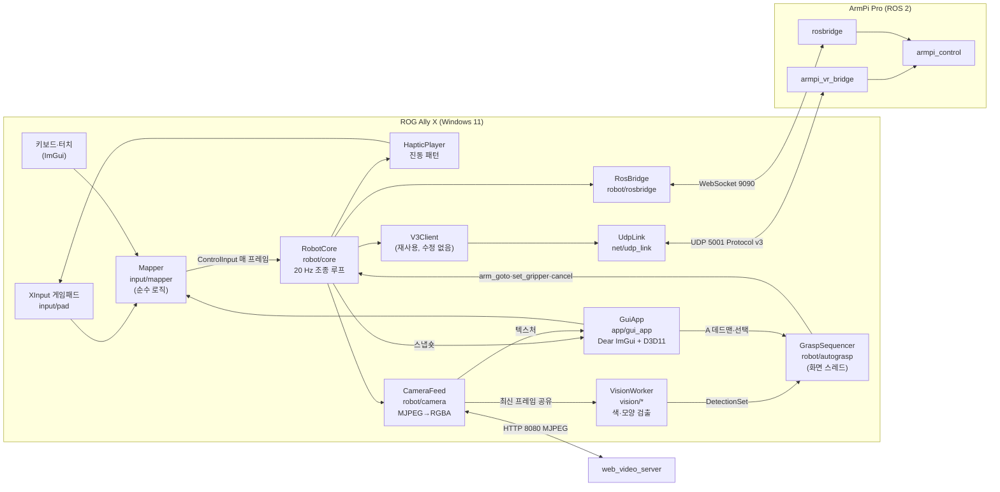

# 구조



## 계층

| 계층 | 파일 | 플랫폼 |
|---|---|---|
| 소켓 | `src/net/sock.*` | Winsock2 / BSD 소켓을 한 헤더로 감쌈. 나머지 네트워크 코드는 이것만 쓴다 |
| 네트워크 | `src/net/{udp_link,discovery,http,websocket,crypto,comm_log}.*` | 공용 |
| 로봇 | `src/robot/{core,rosbridge,camera,image}.*` | 공용 |
| 자동 집기 | `src/robot/autograsp.*`(계획·순서), `src/vision/{image_ops,detector,homography,calibration,vision_worker}.*` | 공용, 외부 라이브러리 없음 |
| 입력 | `src/input/pad.*`(XInput은 Windows만, 그 밖에는 빈 구현), `src/input/mapper.*`, `src/input/tilt.*`(기울기 계산은 공용, 센서는 Windows 센서 API) | 공용 |
| 화면 | `src/app/gui_app.*`(ImGui 위젯), `src/app/grasp_tab.cpp`(집기 탭·영상 오버레이·보정), `src/app/gui_main.cpp`(Win32·D3D11) | Windows |
| 콘솔 | `src/app/cli_main.cpp` (`discover`, `selftest`, `grasp-selftest`, `pads`) | 공용 |
| 재사용 | `third_party/armpi/` Protocol v3 클라이언트·JSON·기구학 | 공용, 수정 없음 |

공용 부분은 맥에서도 빌드돼 단위 시험과 가짜 로봇 종단 시험을 돌린다. Windows 전용은 화면 두 파일과 XInput 부분뿐이다.

## 스레드

| 스레드 | 주기 | 하는 일 |
|---|---|---|
| 화면(메인) | 화면 주사율(최대 120 Hz, 설정으로 60·30) | 패드·키·터치 읽기 → `Mapper` → `RobotCore::set_input`(심장 박동), ImGui 그리기, 진동 출력 |
| 조종 | 50 ms 고정 | 입력이 0.3초 넘게 안 오면 중립, 팔 목표 램프·보정, `V3Client::tick`(차체·팔 패킷), ACK 처리, 스냅숏 갱신 |
| rosbridge | 수신 대기 | 상태·배터리·관절·적용 목표 구독, 서비스 호출, 2초 재연결 |
| 카메라 | 수신 대기 | MJPEG 프레임 → stb_image 해독 → 최신 프레임 1장 보관 |
| 검출(VisionWorker) | 최대 10 Hz, 집기 탭에서만 | 최신 프레임(복사 없이 공유) → 1/2 축소 HSV → 색별 마스크·연결 성분 → 모양 점수 → 추적 ID, 침입 감지용 1/8 밝기 축소본. 640×480에서 약 6 ms |
| 기울기 센서 | 약 20 Hz, 기울기 주행을 처음 쓸 때 시작 | COM(MTA)에서 가속도계 `GetData` → 마지막 값 보관. 센서 호출이 몇 초 멈출 수 있어 화면 스레드와 분리. 1초 넘게 갱신이 없으면 화면은 값을 쓰지 않는다 |
| 검색 | 요청 시 1.5초 | UDP 5002 브로드캐스트 |

조종 스레드는 화면과 따로 돌기 때문에, 화면이 느려지거나 멈춰도 ACK 처리·비상정지 재전송·중립 전환은 계속된다.

자동 집기 순서(`GraspSequencer`)는 일부러 **화면 스레드**에서 돈다(내부 20 Hz 제한). 조종 루프는 화면이 새 입력을 줄 때만 목표를 움직이므로, 화면이 멈추거나 포커스를 잃으면 자동 동작도 함께 선다. 순서는 `RobotCore`의 공개 함수(`arm_goto`, `set_gripper`, `cancel_goal`, `snapshot`, `reachable`)만 부른다.

## 자동 집기

```
영상(관측 자세) ─> 색·모양 검출 ─> 사용자가 고름(영상 누르기 / D-pad / 목록)
   ─> 픽셀 → 책상 좌표(호모그래피 H⁻¹, 보정 파일) ─> 계획: pitch −90°, −75°, −60°, −50° 중 위로·잡기·들기가 모두 닿는 첫 값
   ─> [A 누르는 동안] 관측 → 계획 → (하강 전 확인) → 열기 → 위로 → 하강(느리게) → 닫기 → 들기(느리게) → 관측 자세에서 확인
```

- 목표마다 `RobotCore`가 ID를 주고, 스냅숏의 `goal_result`(도달·정지·취소)로 단계를 넘긴다. 스냅숏이 아직 이전 ID면 기다리고, 더 새 ID면 사람이 다른 명령을 준 것으로 보고 멈춘다.
- 보정은 **관측 자세에서 찍은 영상 + 책상 평면** 하나로 한다. 카메라가 팔에 붙었든 차체에 붙었든 같은 절차다: 관측 자세에서 책상 위 표시를 누르고, 팔 끝을 그 표시에 맞춰 저장하는 점을 4–6개 모은다(`%LOCALAPPDATA%\ArmPi_Ally_Controller\vision_calib.json`).
- 물체 색 사전은 기본값(빨강·파랑·초록·노랑 블록 3 cm·공 4 cm)이고, 같은 폴더의 `vision_colors.json`으로 바꿀 수 있다. 두 파일 모두 읽을 때 값 범위를 검사한다.
- **물체 높이 보정**: 카메라가 비스듬하면 높이 h인 점은 책상 평면에서 `h × (px, py)`만큼 밀려 보인다. 보정 마법사에서 책상 표시와 그 위에 올린 블록 윗면을 누르면 이 시차 벡터를 재고, 검출 중심(높이 h/2로 봄)을 물체 바닥 위치로 되돌린다.
- **차체 접근(시험 기능)**: 계획이 '팔이 닿지 않음'이면 `kApproachBase`로 간다. 새 프레임마다 물체를 다시 찾아 책상 좌표로 바꾸고, 방향이 6°보다 틀어져 있으면 회전, 아니면 전진(너무 가까우면 후진)을 0.3초짜리 명령으로 보낸다(`RobotCore::set_auto_base`). 계획이 서면 서서 관측부터 다시 한다. 2초마다 0.6초 서서 보고, 모두 20초까지.
- **침입 감지(시험 기능)**: 관측 자세의 1/8 밝기 영상을 기준으로, 팔이 지날 통로(팔 뿌리 → 관측 자세 손끝·집기 점, 시차 방향으로 25 cm 높이까지)와 물체 둘레를 뺀 영역의 큰 변화만 본다.
- 시험: `tools/fake_cam_server.py`(합성 책상 영상, `/control?remove=N`로 물체를 치움, `--follow-robot`이면 가짜 로봇 rosbridge의 주행 기록을 따라 물체를 움직임) + 가짜 로봇 + `armpi-ally-cli grasp-selftest`.

## 멀티터치

Windows는 첫 손가락(primary)을 마우스 메시지로 바꿔 주고, ImGui는 이것만 따른다. `gui_main.cpp`가 `WM_POINTER*`로 나머지 손가락을 따로 모아 매 프레임 `UiContext::touches`로 넘긴다. 가상 스틱·회전 슬라이더·누르고 있는 버튼은 손가락이 처음 닿은 자리로 그 손가락을 '차지'하고(`w::touch_claim`), 비상정지는 어느 손가락이든 닿는 순간 발동한다(`w::touch_pressed_in`). `--demo-touch`는 Ally에서 두 손가락을 주입해 이것을 확인한다(우리 창이 맨 위일 때만).

## 팔 목표 흐름

```
스틱/버튼 속도 ─┐
                ├─> 목표 램프(0.15 m/s, 0.6 rad/s, 0.8/s) ─> TargetProjector(앱) ─> arm_command(절대 목표, 20 Hz)
터치/숫자 목표 ─┘                                                 ↑
                                     로봇이 보정했다고 알리면(/armpi_vr_bridge/state) 로봇이 쓰는 목표로 되돌림
```
