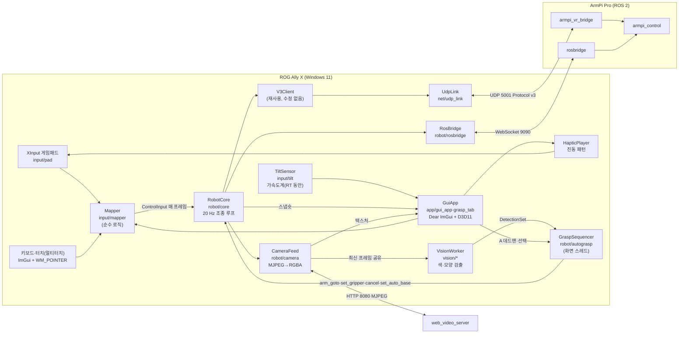

# 구조

현재 버전 0.4.3.



## 계층

| 계층 | 파일 | 플랫폼 |
|---|---|---|
| 소켓 | `src/net/sock.*` | Winsock2 / BSD 소켓을 한 헤더로 감쌈. 나머지 네트워크 코드는 이것만 쓴다 |
| 네트워크 | `src/net/{udp_link,discovery,http,websocket,crypto,comm_log}.*` | 공용 |
| 로봇 | `src/robot/{core,rosbridge,camera,image}.*` | 공용 |
| 자동 집기 | `src/robot/autograsp.*`(계획·순서), `src/vision/{image_ops,detector,homography,calibration,vision_worker}.*` | 공용, 외부 라이브러리 없음 |
| 입력 | `src/input/pad.*`(XInput), `src/input/mapper.*`, `src/input/tilt.*`(기울기 계산은 공용, 센서는 Windows 센서 API) | 공용(Windows 밖에서는 빈 구현) |
| 화면 | `src/app/gui_app.*`, `src/app/grasp_tab.cpp`(집기 탭·영상 오버레이·보정), `src/app/ui_theme.*`·`ui_widgets.*`(디자인 토큰·위젯), `src/app/gui_main.cpp`(Win32·D3D11·터치) | Windows |
| 콘솔 | `src/app/cli_main.cpp`(`discover`, `selftest`, `grasp-selftest`, `pads`, `tilt`, `version`) | 공용 |
| 시험 도구 | `tools/fake_cam_server.py`(합성 책상 카메라), `test/*` | 공용(파이썬 표준 라이브러리) |
| 재사용 | `third_party/armpi/` Protocol v3 클라이언트·JSON·기구학 | 공용, 수정 없음 |

공용 부분은 맥·리눅스에서도 빌드돼 단위 시험과 가짜 로봇 종단 시험을 돌린다. Windows 전용은 화면(`src/app` 화면 파일)과 XInput·기울기 센서 부분뿐이다.

## 스레드

| 스레드 | 주기 | 하는 일 |
|---|---|---|
| 화면(메인) | 화면 주사율(최대 120 Hz, 설정으로 60·30) | 패드·키·터치·기울기 읽기 → `Mapper` → `RobotCore::set_input`(심장 박동), 자동 집기 순서, ImGui 그리기, 진동 출력 |
| 조종 | 50 ms 고정 | 입력이 0.3초 넘게 안 오면 중립, 팔 목표 램프·보정, 차체 자동 명령(수명 확인), `V3Client::tick`(차체·팔 패킷), ACK 처리, 스냅숏 갱신 |
| rosbridge | 수신 대기 | 상태·배터리·관절·적용 목표 구독, 서비스 호출, 다시 연결(2→10초) |
| 카메라 | 수신 대기 | MJPEG 프레임 → stb_image 해독 → 최신 프레임 1장 보관 |
| 검출(VisionWorker) | 최대 10 Hz, 집기 탭에서만 | 최신 프레임(복사 없이 공유) → 1/2 축소 HSV → 색별 마스크·연결 성분 → 모양 점수(공: 테두리 거리의 변동 계수 ≤ 0.06, 블록: 회전 무관 직사각형 채움 ≥ 0.82) → 추적 ID, 침입 감지용 1/8 밝기 축소본. 640×480에서 약 6 ms |
| 기울기 센서 | 약 20 Hz, 기울기 주행을 켰을 때 | COM(MTA)에서 가속도계 `GetData` → 마지막 값 보관. 센서 호출이 가끔 몇 초 멈추므로 화면과 분리하고, 1초 넘게 갱신이 없으면 화면은 값을 쓰지 않는다. 종료 때 1초 안에 안 끝나면 스레드를 놓아 준다(공유 상태는 `shared_ptr`) |
| 검색 | 요청 시 1.5초 | UDP 5002 브로드캐스트 |

조종 스레드는 화면과 따로 돌기 때문에, 화면이 느려지거나 멈춰도 ACK 처리·비상정지 재전송·중립 전환은 계속된다.

자동 집기 순서(`GraspSequencer`)는 일부러 **화면 스레드**에서 돈다(내부 20 Hz 제한). 조종 루프는 화면이 새 입력을 줄 때만 목표를 움직이므로, 화면이 멈추거나 포커스를 잃으면 자동 동작도 함께 선다. 순서는 `RobotCore`의 공개 함수(`arm_goto`, `set_gripper`, `cancel_goal`, `snapshot`, `reachable`, `set_auto_base`)만 부른다.

## 팔 목표 흐름

```
스틱/버튼 속도 ─┐
                ├─> 목표 램프(0.15 m/s, 0.6 rad/s, 0.8/s) ─> TargetProjector(앱) ─> arm_command(절대 목표, 20 Hz)
터치/숫자 목표 ─┤                                                 ↑
자동 집기 목표 ─┘ (목표 ID·결과)       로봇이 보정했다고 알리면(/armpi_vr_bridge/state) 로봇이 쓰는 목표로 되돌림(5 cm 안만)
```

절대 목표(`arm_goto`, `set_gripper`)마다 `RobotCore`가 ID를 주고, 스냅숏의 `goal_result`(도달·정지·취소)와 남은 거리로 결과를 알린다. 스틱 입력·팔 끄기·비상정지·세션 해제·유휴 꺼짐은 모두 목표를 '취소'로 끝낸다.

## 자동 집기

```
영상(관측 자세) ─> 색·모양 검출 ─> 사용자가 고름(영상 누르기 / D-pad / 목록)
   ─> 픽셀 → 책상 좌표(호모그래피 H⁻¹ + 물체 높이 보정) ─> 계획: pitch −90°, −75°, −60°, −50° 중 위로·잡기·들기가 모두 닿는 첫 값
   ─> [A 누르는 동안] 관측 → 계획 →(범위 밖이면 차체 접근)→ 하강 전 확인 → 열기 → 위로 → 하강(느리게) → 닫기 → 들기(느리게) → 관측 자세에서 확인
```

- **단계 넘기기**: 스냅숏이 아직 이전 목표 ID면 기다리고, 더 새 ID면 사람이 다른 명령을 준 것으로 보고 일시정지한다. 하강·들기가 닿지 않으면(정지) 높이를 바꿔 한 번 다시 한다. 마지막에 관측 자세로 돌아가 원래 자리(±25 px)에 물체가 없으면 성공.
- **보정**은 관측 자세에서 찍은 영상 + 책상 평면 하나로 한다. 카메라가 팔에 붙었든 차체에 붙었든 같은 절차다: 관측 자세에서 책상 위 표시를 누르고, 팔 끝을 그 표시에 맞춰 저장하는 점을 4–6개 모은다. 호모그래피는 정규화 DLT(8×8 정규방정식, 부분 피벗 가우스 소거)로 푼다.
- **물체 높이 보정**: 카메라가 비스듬하면 높이 h인 점은 책상 평면에서 `h × (px, py)`만큼 밀려 보인다. 책상 표시와 그 위에 올린 블록 윗면을 누르면 이 시차 벡터를 재고, 검출 중심(높이 h/2로 봄)을 물체 바닥 위치로 되돌린다.
- **물체 색**: 기본은 빨강·파랑·초록·노랑 블록 3 cm·공 4 cm. 영상에서 물체를 눌러 색 범위를 다시 잡으면 같은 색의 블록·공에 함께 적용된다.
- **차체 접근(시험 기능)**: 계획이 '팔이 닿지 않음'이고 물체가 20–60 cm·옆 90° 안이면 `kApproachBase`로 간다. 새 프레임마다 같은 물체(같은 색, 이전 위치 80 px 안)를 다시 찾아 책상 좌표로 바꾸고, 방향이 6°보다 틀어져 있으면 회전, 아니면 전진 명령을 짧은 수명(≤ 0.3초, 남은 시간 이하)으로 보낸다(`RobotCore::set_auto_base`: 속도 상한 30 % 이하·비상정지 아닐 때만, 사용자 주행 입력이 오면 즉시 끝). 2초마다 0.6초 서서 진척(거리 1 cm 또는 방향 2°)을 확인하고, 없으면 중단한다. 후진하지 않는다. 계획이 서면 서서 관측부터 다시 한다. 접근 3번·모두 20초까지.
- **침입 감지(시험 기능)**: 관측 자세의 1/8 밝기 영상을 기준으로, 팔이 지날 통로(팔 뿌리 → 관측 자세 손끝·집기 점, 시차 방향으로 25 cm 높이까지)와 물체 둘레를 뺀 영역의 큰 변화만 본다. 팔이 움직이기 전의 화면 전체 변화는 일시정지, 팔이 움직이는 동안 3프레임 이어지면 카메라가 팔에 달린 것으로 보고 끈다.
- **시험**: `tools/fake_cam_server.py`가 합성 책상 영상을 내보내고(`/control?remove=N`으로 들린 물체를 치움), `--follow-robot`이면 가짜 로봇 rosbridge의 주행 기록(odom + 명령 속도)을 따라 물체를 움직인다. `armpi-ally-cli grasp-selftest`가 이 둘과 가짜 로봇으로 전체 과정을 돈다.

## 입력

### 멀티터치

Windows는 첫 손가락(primary)을 마우스 메시지로 바꿔 주고, ImGui는 이것만 따른다. `gui_main.cpp`가 `WM_POINTER*`로 나머지 손가락을 모아 매 프레임 `UiContext::touches`로 넘긴다(떼어진 손가락도 화면이 한 번 본 뒤에 지워, 짧은 탭이 사라지지 않는다).

- 가상 스틱·회전 슬라이더·누르고 있는 버튼은 손가락이 **닿는 순간** 그 자리에 있으면 그 손가락을 차지한다(`w::touch_claim`). 대고 있던 손가락 아래로 나타난 버튼은 눌리지 않는다.
- 비상정지는 어느 손가락이든 닿는 순간 발동한다(`w::touch_pressed_in`).
- `--demo-touch`(자동 점검 + 데모 연결일 때만)는 Ally에서 두 손가락을 주입해 이것을 확인한다. 첫 손가락은 스틱 정중앙을 잡기만 하고(주행 명령 없음), 우리 창이 그 자리 맨 위일 때만 주입한다.

### 기울기 주행

- pitch = 중력과 화면 평면 사이 각, roll = 중력의 오른쪽 성분 각. 핸들처럼 돌리면(화면 법선 회전) roll만, 앞뒤로 기울이면 pitch만 바뀐다.
- RT를 누른 뒤 들어온 첫 값을 기준으로 상대 각을 쓰고, 5° 데드존과 최대 각(12–45°)으로 −1..1에 맞춘 뒤 스틱 입력에 더한다(`input::tilt_to_drive`).
- 계산은 순수 함수라 단위 시험이 있고, 센서는 `TiltSensor`(Windows 센서 API, 별도 스레드)다.

## 파일

`%LOCALAPPDATA%\ArmPi_Ally_Controller\`(맥·리눅스에서는 `~/.config/armpi_ally/`):

| 파일 | 내용 | 읽을 때 검사 |
|---|---|---|
| `settings.json` | 주소·포트·입력·화면·집기·기울기 설정 | 값 범위, 주소 문자 제한 |
| `vision_calib.json` | 카메라 보정(해상도, 관측 자세, 책상 높이, 시차, 대응점, H) | 범위·유한값, 대응점 64개 이하, H는 점에서 다시 계산 |
| `vision_colors.json` | 물체 색 사전(색 다시 찍기) | 256 KB, 32종 이하, 값 범위 |
| `ally_*.log`, `boot.log` | 사건 기록(최근 20개), 시작 기록 | — |
| `captures/cap_*.bmp` | 화면 저장(F12·진단 탭·`capture.request`), 최근 200장 | — |
| `capture.request` | 원격 화면 저장 요청(비어 있으면 한 장, `burst N S`면 연속). 앱이 0.5초마다 보고 지운다 | 64바이트, N 1–100, S 0.1–2초 |

쓰기는 임시 파일 → 이름 바꾸기로 한다. 데모 실행(`--demo-connect`)은 설정·보정·색 파일을 저장하지 않는다.
