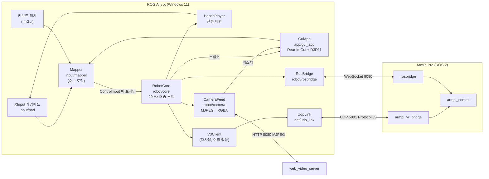

# 구조



## 계층

| 계층 | 파일 | 플랫폼 |
|---|---|---|
| 소켓 | `src/net/sock.*` | Winsock2 / BSD 소켓을 한 헤더로 감쌈. 나머지 네트워크 코드는 이것만 쓴다 |
| 네트워크 | `src/net/{udp_link,discovery,http,websocket,crypto,comm_log}.*` | 공용 |
| 로봇 | `src/robot/{core,rosbridge,camera,image}.*` | 공용 |
| 입력 | `src/input/pad.*`(XInput은 Windows만, 그 밖에는 빈 구현), `src/input/mapper.*` | 공용 |
| 화면 | `src/app/gui_app.*`(ImGui 위젯), `src/app/gui_main.cpp`(Win32·D3D11) | Windows |
| 콘솔 | `src/app/cli_main.cpp` (`discover`, `selftest`, `pads`) | 공용 |
| 재사용 | `third_party/armpi/` Protocol v3 클라이언트·JSON·기구학 | 공용, 수정 없음 |

공용 부분은 맥에서도 빌드돼 단위 시험과 가짜 로봇 종단 시험을 돌린다. Windows 전용은 화면 두 파일과 XInput 부분뿐이다.

## 스레드

| 스레드 | 주기 | 하는 일 |
|---|---|---|
| 화면(메인) | 화면 주사율(최대 120 Hz, 설정으로 60·30) | 패드·키·터치 읽기 → `Mapper` → `RobotCore::set_input`(심장 박동), ImGui 그리기, 진동 출력 |
| 조종 | 50 ms 고정 | 입력이 0.3초 넘게 안 오면 중립, 팔 목표 램프·보정, `V3Client::tick`(차체·팔 패킷), ACK 처리, 스냅숏 갱신 |
| rosbridge | 수신 대기 | 상태·배터리·관절·적용 목표 구독, 서비스 호출, 2초 재연결 |
| 카메라 | 수신 대기 | MJPEG 프레임 → stb_image 해독 → 최신 프레임 1장 보관 |
| 검색 | 요청 시 1.5초 | UDP 5002 브로드캐스트 |

조종 스레드는 화면과 따로 돌기 때문에, 화면이 느려지거나 멈춰도 ACK 처리·비상정지 재전송·중립 전환은 계속된다.

## 팔 목표 흐름

```
스틱/버튼 속도 ─┐
                ├─> 목표 램프(0.15 m/s, 0.6 rad/s, 0.8/s) ─> TargetProjector(앱) ─> arm_command(절대 목표, 20 Hz)
터치/숫자 목표 ─┘                                                 ↑
                                     로봇이 보정했다고 알리면(/armpi_vr_bridge/state) 로봇이 쓰는 목표로 되돌림
```
